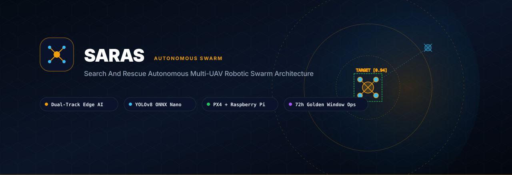
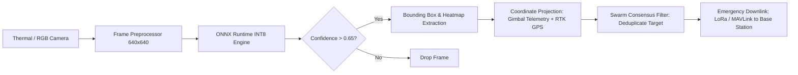

<p align="center">
  
</p>

<p align="center">
  <strong>Dual-Track Edge AI Multi-UAV Robotic Swarm for Rapid Disaster Victim Localization within the 72-Hour Golden Window</strong>
</p>

<p align="center">
  <a href="https://github.com/AbinVarghexe/SARAS-Swarm-System/blob/main/LICENSE"></a>
  <a href="https://www.python.org/downloads/"></a>
  <a href="https://docs.ultralytics.com/"></a>
  <a href="https://px4.io/"></a>
  <a href="https://mavlink.io/en/"></a>
</p>

---

## Overview

**SARAS** (Search And Rescue Autonomous Swarm) is a distributed edge-computing UAV swarm platform architected specifically for post-disaster humanitarian operations. During earthquakes, landslides, floods, and structural collapses, victim survivability decays exponentially beyond the 72-hour mark. SARAS replaces slow manual search patterns with autonomous coordinated multi-drone sweeps, on-device neural thermal/RGB human detection, and real-time localized mesh telemetry.

```
                  +-----------------------------------+
                  |   Base Ground Station (GCS / QGC) |
                  +-----------------+-----------------+
                                    | Mesh Wi-Fi / LoRa
         +--------------------------+--------------------------+
         |                                                     |
         v                                                     v
+------------------------+                           +------------------------+
| UAV Alpha (Recon 01)   |                           | UAV Bravo (Recon 02)   |
| - Companion Pi / Jetson| <====== Peer-to-Peer ===> | - Companion Pi / Jetson|
| - Pixhawk 6C (PX4)     |    MAVLink State Sync     | - Pixhawk 6C (PX4)     |
| - Dual Thermal/RGB Cam |                           | - Dual Thermal/RGB Cam |
| - YOLOv8 ONNX Runtime  |                           | - YOLOv8 ONNX Runtime  |
+------------------------+                           +------------------------+
```

## Key Capabilities

- **Dual-Track Real-Time Vision**: Concurrent processing of visible spectrum (RGB) and long-wave infrared (LWIR) feeds utilizing an INT8 quantized YOLOv8 neural network executed directly on edge companion computers (Raspberry Pi 4/5 / NVIDIA Jetson).
- **PX4 & MAVLink Integration**: High-frequency bidirectional flight-controller communication over hardware UART utilizing MAVLink 2.0 and MAVSDK-Python, orchestrating autonomous waypoint navigation, orbit patterns, and dynamic geofenced search corridors.
- **Decentralized Swarm Coordination**: Area-partitioning algorithms distribute search sectors across participating drones without single points of failure, automatically reallocating sectors if a drone returns to home (RTH) for battery replacement.
- **Human Survivor Geolocation**: Combines gimbal pitch/yaw telemetry, laser rangefinder altitude, and RTK GPS coordinates to project image pixel detections into precise ground-plane geographic coordinates (latitude, longitude, CEP50 < 1.5m).
- **Offline Resilient Operation**: Operates with zero cloud or cellular dependence, broadcasting low-bandwidth victim coordinate markers and situational thermal thumbnails over 915MHz LoRa and 2.4/5.8GHz ad-hoc radio meshes.

## Architecture & Hardware Stack

| Subsystem | Hardware Component | Role & Protocol |
| :--- | :--- | :--- |
| **Flight Control Unit (FCU)** | Pixhawk 6C / Holybro PX4 | 400Hz attitude estimation, stabilization, fail-safe RTL |
| **Companion Computer** | Raspberry Pi 4B (4GB) / Jetson Orin Nano | Edge ML inference, search orchestration, MAVLink bridge |
| **Sensors** | FLIR Boson / Lepton 3.5 + Sony IMX708 | Radiometric thermal LWIR & high-resolution RGB imagery |
| **Range & Positioning** | Holybro H-RTK F9P GNSS + Benewake TF-Mini | Centimeter-grade RTK positioning & laser AGL altitude |
| **Comms Mesh** | Holybro SiK Telemetry 915MHz + ESP-NOW / WiFi | Telemetry downlink and swarm consensus broadcast |

## Detection & Pipeline Architecture



## Getting Started

### Prerequisites

- Python 3.10 or higher
- System libraries: `libgl1-mesa-glx`, `libglib2.0-0` (for OpenCV edge runtime)
- PX4 SITL simulator or physical Pixhawk connected via `/dev/ttyAMA0` or USB COM port

### Installation

```bash
# Clone the repository
git clone https://github.com/AbinVarghexe/SARAS-Swarm-System.git
cd SARAS-Swarm-System

# Create and activate a virtual environment
python -m venv venv
source venv/bin/activate  # On Windows: .\venv\Scripts\activate

# Install dependencies
pip install -r requirements.txt
```

### Running with PX4 SITL Simulator

```bash
# Launch the SITL simulation bridge
python scripts/sitl_swarm_bridge.py --uav-count 2 --headless

# Run the vision & autonomous sweep pipeline on UAV-01
python main.py --drone-id uav-01 --connection udp://:14540 --model models/yolov8n_thermal_int8.onnx
```

## Repository Structure

```
SARAS-Swarm-System/
├── assets/
│   └── banner.svg               # Vector visual banner
├── models/                      # Quantized YOLOv8 ONNX models
├── src/
│   ├── autonomy/                # Sector partition, sweep patterns, RTH
│   ├── comms/                   # MAVLink 2.0 transceiver & LoRa packetizer
│   ├── detection/               # ONNX Runtime vision pipeline & NMS
│   └── localization/            # Camera projection & coordinate mapping
├── tests/                       # Unit tests and hardware mock telemetry
├── requirements.txt             # Python dependencies
└── README.md                    # System documentation
```

## License

This project is licensed under the MIT License - see the [LICENSE](LICENSE) file for details.
