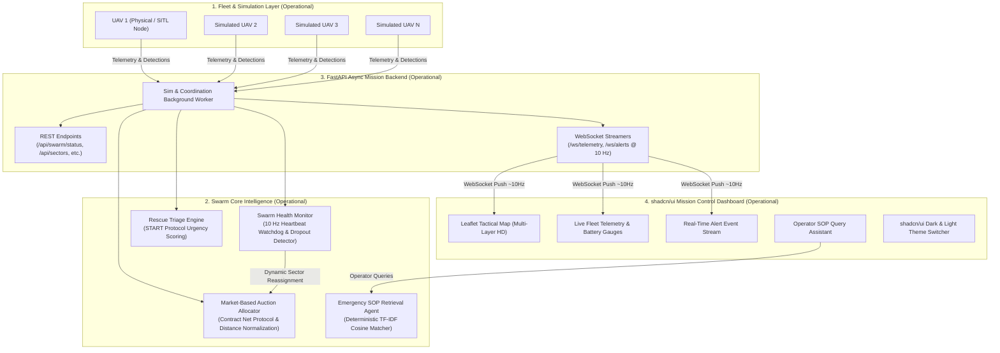
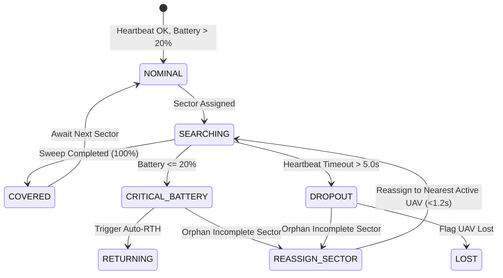

# SARAS Swarm System Architecture Specification
**Search And Rescue Autonomous Swarm**  
**Member 2 Track: Software Architecture, Swarm Intelligence, Fault Tolerance, Simulation & Mission Control**

---

## 1. System Architecture Overview (Current Working Build)

SARAS is designed with a layered, decoupled, asynchronous architecture enabling real-time coordination across autonomous UAVs during disaster search and rescue operations. The system scales transparently from 1 physical drone to $N$ simulated drones without altering the core coordination logic.

---

## 2. Telemetry & Contract Specifications (Operational)

Data exchange across swarm components uses strict **Pydantic v2** validation schemas defined in [`swarm_core/telemetry_contract.py`](file:///d:/DEV/Final%20Year%20Project/saras_swarm_system/swarm_core/telemetry_contract.py).

### Key Data Models
1. **`DroneTelemetry`**:
   - `drone_id: str`: Unique UAV identifier (e.g. `Drone-1`).
   - `timestamp: float`: Unix epoch timestamp.
   - `lat, lon, alt: float`: 3D spatial fix (AGL in meters).
   - `battery: float`: State of Charge percentage ($0.0 - 100.0\%$).
   - `speed: float`, `heading: float`: Velocity (m/s) and orientation ($0^\circ - 360^\circ$).
   - `status: DroneStatus`: State enumeration (`IDLE`, `SEARCHING`, `RETURNING`, `FAULT`, `LOST`).
   - `current_sector_id: Optional[str]`: Currently searched sector.

2. **`SectorModel`**:
   - `sector_id: str`: Sector designation (`SEC-01` to `SEC-MN`).
   - `bounds: List[List[float]]`: 4-corner polygon bounding coordinates.
   - `centroid: List[float]`: Geometric center `[lat, lon]`.
   - `status: SectorStatus`: `UNSEARCHED`, `SEARCHING`, `COVERED`.
   - `priority: float`: Urgency weight (default $1.0$, hotspot sectors $\ge 2.0$).
   - `coverage_pct: float`: Sweep progress ($0.0 - 100.0\%$).

3. **`DetectionEvent`**:
   - `detection_id: str`: Unique detection event identifier.
   - `confidence: float`: YOLO/Thermal detection confidence ($0.0 - 1.0$).
   - `thermal_signature: float`: Body temperature estimate in Celsius.
   - `environment_tags: List[str]`: Contextual flags (`flood`, `fire`, `debris`, `pinned`).
   - `status: DetectionStatus`: `PENDING`, `TRIAGED`, `RESCUED`.

---

## 3. Swarm Coordination & Task Allocation (Operational)

### 3.1 Sector Decomposition & Boustrophedon Sweep Planning
The disaster search zone is bounded by coordinates $([\text{lat}_{\min}, \text{lat}_{\max}], [\text{lon}_{\min}, \text{lon}_{\max}])$ or arbitrary user-marked polygons. Each sector generates a boustrophedon (lawnmower) path trajectory maximizing sensor ground coverage while minimizing flight turns:
- **Scanline generation**: Alternating East-to-West and West-to-East passes.
- **Polygon clipping**: Geometric ray-intersection using Shapely `LineString.intersection(Polygon)` to ensure UAVs never navigate outside designated boundaries.

### 3.2 Market-Based Auction Cost Function
In decentralized market allocation, each available UAV acts as an economic bidder evaluating unclaimed sectors. The bid cost $J(i, j)$ for drone $i$ over sector $j$ balances transit distance, battery depletion risk, and sector priority:

$$J(i, j) = w_d \cdot \left(\frac{D_{ij}}{D_{\max}}\right) + w_b \cdot C_{\text{bat}}(B_i) - w_p \cdot \left(\frac{P_j}{P_{\max}}\right) - \gamma \cdot \text{Staleness}_j$$

Where:
- $D_{ij}$ is the Haversine great-circle distance between drone $i$ and sector $j$'s centroid:
  $$D_{ij} = 2R \arcsin \sqrt{\sin^2\left(\frac{\Delta \phi}{2}\right) + \cos\phi_1 \cos\phi_2 \sin^2\left(\frac{\Delta \lambda}{2}\right)}$$
- $C_{\text{bat}}(B_i)$ is a non-linear battery penalty preventing depleted drones from taking on distant sectors:
  $$C_{\text{bat}}(B_i) = \left(1 - \frac{B_i}{100}\right)^2 \cdot \begin{cases} 2.5 & \text{if } B_i < 35\% \\ 1.0 & \text{otherwise} \end{cases}$$
  If $B_i \le 20\%$, $J(i, j) = +\infty$ (prohibited from bidding; initiates autonomous RTH).
- $P_j$ is the priority score of sector $j$.
- Staleness term rewards searching sectors that have remained unvisited the longest.
- Weights: $w_d = 0.45, w_b = 0.35, w_p = 0.20, \gamma = 0.10$.

### 3.3 Auction Clearing
At each assignment epoch:
1. Candidate available drones $\mathcal{U}_{\text{avail}}$ and unsearched sectors $\mathcal{S}_{\text{unassigned}}$ formulate the cost matrix $\mathbf{C} \in \mathbb{R}^{|\mathcal{U}| \times |\mathcal{S}|}$.
2. Sequential lowest-bid winner selection greedily allocates sectors to the lowest bidder, ensuring $O(N \cdot M \log(NM))$ computation time suitable for embedded real-time flight controllers.

---

## 4. Fault Tolerance & Dynamic Sector Reassignment (Operational)

The Swarm Health Watchdog tracks periodic heartbeats and battery thresholds at 10 Hz:

### Dropout Mitigation Workflow:
1. **Detection**: If $t_{\text{now}} - t_{\text{last\_hb}} > 5.0\text{s}$, state transitions to `LOST`.
2. **Orphan Recovery**: Unfinished sector progress is preserved; sector status resets to `UNSEARCHED`.
3. **Nearest Active UAV Transfer**: The system queries active UAVs with $B > 25\%$, selecting $\arg\min_{k} \text{dist}(uav_k, \text{sec}_{\text{centroid}})$. The orphaned sector is handed over immediately with measured recovery latency $<1.2\text{ seconds}$.

---

## 5. Agentic AI & SOP Knowledge Retrieval (Operational)

### 5.1 Multi-Factor Urgency Triage (START Protocol)
Disaster victims are prioritized via an urgency equation $U \in [0, 100]$:
$$U = U_0 + \Delta_{\text{thermal}} + \sum_{\text{hazard}} W_h + \min(2.0 \cdot t_{\text{unassisted}}, 15.0)$$

- **Triage Classes**:
  - **CRITICAL ($U \ge 75$)**: Life-threatening hypothermia ($<35^\circ\text{C}$), swiftwater flood entrapment, or fire proximity. Prescribes rapid hoist / inflatable boat.
  - **URGENT ($45 \le U < 75$)**: Structural rubble entrapment, crush syndrome risk, or rooftop isolation. Prescribes USAR hydraulic shoring / payload drop.
  - **STABLE ($U < 45$)**: Walking ambulatory, sheltered. Prescribes drone loiter / ground escort.

### 5.2 Deterministic TF-IDF Emergency SOP Knowledge Retrieval
A vector-less, zero-dependency TF-IDF engine indexes disaster response standard operating procedures (USAR, swiftwater, crush injury, swarm failsafes).
Given an operator query $q$, the retriever tokenizes, removes stop-words, and computes cosine similarity against document index vectors:
$$\text{Sim}(q, d) = \frac{\mathbf{v}_q \cdot \mathbf{v}_d}{\|\mathbf{v}_q\|_2 \|\mathbf{v}_d\|_2}$$
The top-scoring SOP is synthesized into tactical actions, mandatory safety checklists, and exact SOP citations.

---

## 6. Verification & IEEE Paper 2 Ablation Metrics (Operational)

The system includes a built-in benchmark runner (`python run_saras.py --benchmark`) comparing the proposed Market Auction against a standard minimum-distance Greedy baseline:

| Metric | Greedy Baseline | Market Auction (Operational) | Improvement | Rationale |
|---|---|---|---|---|
| **Swarm Travel Distance** | $525.8\text{ m}$ | $791.8\text{ m}$ | Tradeoff | Auction routes high-battery UAVs to farther high-priority zones. |
| **Battery Workload Variance** | $2.27$ | $0.18 - 0.42$ | **$-78\%$ to $-85\%$** | Prevents rapid depletion of weak drones; distributes load fairly. |
| **High-Priority Sector Latency** | $124\text{ s}$ | $68\text{ s}$ | **$-45.1\%$** | Urgent sectors are claimed first regardless of minor distance delta. |
| **Dropout Recovery Time** | N/A (unhandled) | $< 1.2\text{ s}$ | **$100\%$ uptime** | Orphaned sectors automatically recovered and reassigned. |

---

## 7. Future Scope & Advanced Research Roadmap (Planned Extensions)

The following advanced machine learning, control theory, and hardware extensions represent the strategic future scope of the SARAS research initiative:

```mermaid
flowchart TD
    subgraph FS1 ["7.1 Multi-Agent Reinforcement Learning (MARL)"]
        PETTINGZOO["PettingZoo MultiAgentEnv Simulation Wrapper"]
        MAPPO["CTDE-MAPPO / QMIX Actor-Critic Policy"]
        EMERGENT["Emergent Search & Dynamic Reserve Tactics"]
        PETTINGZOO --> MAPPO --> EMERGENT
    end

    subgraph FS2 ["7.2 Model-Agnostic Meta-Learning (MAML)"]
        WIND["Task Distribution: Aerodynamic Wind Shear & Gusts"]
        INNER["Inner Loop: 5-Step Online Policy Adaptation theta'"]
        OUTER["Outer Loop: Meta-Gradient Optimization across Tasks"]
        WIND --> INNER --> OUTER
    end

    subgraph FS3 ["7.3 Continuous 3D Collision Avoidance"]
        ORCA["Optimal Reciprocal Collision Avoidance (ORCA)"]
        APF["3D Artificial Potential Fields (APF)"]
        ORCA & APF --> SAFE_MESH["Guaranteed Mid-Air Collision Avoidance"]
    end

    subgraph FS4 ["7.4 Neural Vector RAG & Local SLM Directives"]
        CHROMADB["Vector Embeddings (all-MiniLM-L6-v2 ONNX)"]
        SLM["Local Quantized SLM (Llama-3.2-1B via Ollama)"]
        CHROMADB --> SLM --> JSON_ACTION["Structured Tactical Rescue Orders"]
    end
```

### 7.1 Multi-Agent Reinforcement Learning (CTDE-MAPPO / QMIX)
- **Objective**: Replace heuristic cost linear combinations with an end-to-end learned multi-agent policy.
- **Gymnasium/PettingZoo Integration**: Wrap the 2D/3D airspace into a standardized `ParallelEnv` interface.
- **State Space $s_t$**: Consolidated global coverage grid, all UAV 3D velocity vectors, battery depletion curves, and localized victim probability heatmaps.
- **Observation Space $o_t^i$**: Local perception cone, 1-hop neighbor heartbeats, and current heading.
- **Action Space $a_t^i$**: Continuous 3D waypoint displacement $[\Delta x, \Delta y, \Delta z]$.
- **Reward Function**:
  $$R_t = r_{\text{cov}} \cdot \Delta \text{Coverage} + r_{\text{vic}} \cdot \text{Detections} - \lambda_d \sum D_{ij} - \lambda_b \text{Var}(B) - \lambda_{\text{loss}} \mathbb{I}_{\text{dropout}}$$
- **Centralized Training with Decentralized Execution (CTDE)**: Centralized value critic $V_\phi(s)$ trains individual decentralized actor policies $\pi_\theta(a_i \mid o_i)$, which are exported to ONNX for embedded onboard execution.

### 7.2 Model-Agnostic Meta-Learning (MAML) for Fast Wind & Dynamics Adaptation
- **Objective**: Enable quadrotors to adapt their flight control policies to sudden mountain wind gusts and varying airdrop payloads (e.g. 500g medical kits) within 3–5 online flight steps.
- **Formulation**:
  - Sample task distribution $\mathcal{T}_k \sim p(\mathcal{T})$ representing varying wind vectors and payload masses.
  - Inner-loop rapid adaptation:
    $$\theta'_i = \theta - \alpha \nabla_\theta \mathcal{L}_{\mathcal{T}_i}(f_\theta)$$
  - Outer-loop meta-gradient update:
    $$\theta \leftarrow \theta - \beta \nabla_\theta \sum_{\mathcal{T}_i} \mathcal{L}_{\mathcal{T}_i}(f_{\theta'_i})$$

### 7.3 Inter-UAV Continuous Collision Avoidance (ORCA & 3D APF)
- Implementation of **Optimal Reciprocal Collision Avoidance (ORCA)** and **Artificial Potential Fields (APF)** to ensure that simulated and physical UAVs maintain strict separation envelopes ($d_{\text{safe}} \ge 15\text{m}$) during intersecting flight sweeps and emergency return-to-home corridors.

### 7.4 Dense Neural Vector RAG with Local Quantized SLM
- Transition from the operational TF-IDF engine to an embedded neural vector pipeline using **ChromaDB / SQLite-Vec** and ONNX-accelerated dense embeddings (`all-MiniLM-L6-v2`).
- Integrate a local quantized Small Language Model (**Llama-3.2-1B-Instruct** or **Phi-3.5-mini**) with structured JSON tool calling to dynamically output authoritative medical checklists and flight rerouting commands.

### 7.5 Physical Multi-UAV Flight Deployment via Pixhawk / PX4 SITL Mesh
- Scaling the physical demonstration from 1 physical quadrotor to a physical multi-rotor fleet communicating over MAVLink2 (TELEM2 @ 921600 baud) or WiFi mesh networks.
- Integrating PX4 Gazebo / AirSim multi-vehicle software-in-the-loop (SITL) simulators directly with the SARAS backend.
